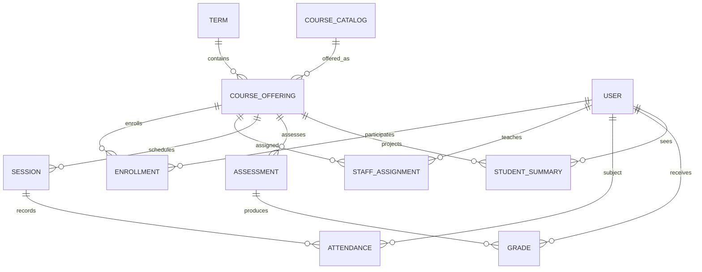

# 02 — Firestore data model v1.0

## 1. Сущности и физические пути
**Правило:** `courseCatalog` — тип дисциплины, `offerings` — конкретное проведение в определённый триместр. В IDs не вшивать фамилии, почты и название курса.

| Path | Основные поля | Canonical / Projection | Кто записывает |
|---|---|---|---|
| `users/{uid}` | `displayName`, `status`, `createdAt`, `roles` (для UI, не полномочия) | Identity metadata | trusted backend |
| `terms/{termId}` | `label`, `startsAt`, `endsAt`, `status` | Canonical | admin seed |
| `courseCatalog/{courseCode}` | `code`, `title`, `credits` (optional) | Canonical | admin seed |
| `offerings/{offeringId}` | `courseCode`, `termId`, `title`, `scoringPolicy`, `policyVersion`, `status`, `revision` | Aggregate root | backend |
| `offerings/{id}/staff/{teacherUid}` | `status`, `permissions[]`, `assignedAt` | Authority | admin backend |
| `offerings/{id}/enrollments/{studentUid}` | `status`, `groupId`, `enrolledAt` | Authority | admin backend |
| `offerings/{id}/sessions/{sessionId}` | `startsAt`, `durationMinutes`, `type`, `status`, `maxAttendancePoints`, `revision` | Canonical | teacher API |
| `offerings/{id}/attendanceRecords/{sessionId}_{studentUid}` | `sessionId`, `studentUid`, `status`, `pointsAwarded`, `publication`, `revision`, `updatedBy`, `updatedAt` | Canonical | teacher API |
| `offerings/{id}/assessments/{assessmentId}` | `category`, `title`, `maxPoints`, `dueAt`, `status`, `revision` | Canonical | teacher API |
| `offerings/{id}/taskCompletionRecords/{assessmentId}_{studentUid}` | `assessmentId`, `studentUid`, `state` (`submitted/late_submitted/missing/pending/excused`), `dueAtSnapshot`, `publication`, `revision` | Canonical | teacher API |
| `offerings/{id}/gradeRecords/{assessmentId}_{studentUid}` | `studentUid`, `assessmentId`, `state`, `pointsEarned`, `publication`, `revision`, `updatedBy` | Canonical | teacher API |
| `students/{uid}/courseSummaries/{offeringId}` | `metrics`, `risk`, `reasons[]`, `actions[]`, `sourceRevision`, `updatedAt`, `freshness` | Materialized view | backend worker |
| `students/{uid}/attendanceItems/{offeringId}_{sessionId}` | `offeringId`, `sessionId`, `startsAt`, `status`, `points` | Published read projection | backend worker |
| `students/{uid}/taskItems/{offeringId}_{assessmentId}` | `offeringId`, `assessmentId`, `state`, `dueAt` | Published read projection | backend worker |
| `students/{uid}/gradeItems/{offeringId}_{assessmentId}` | `offeringId`, `assessmentId`, `title`, `pointsEarned`, `maxPoints`, `state` | Published read projection | backend worker |
| `operationReceipts/{actorUid}_{requestId}` | `payloadHash`, `status`, `response`, `createdAt`, `expiresAt` | Idempotency | backend |
| `dirtySummaries/{offeringId}_{studentUid}` | `sourceRevision`, `status`, `requestedAt`, `retryCount`, `lastErrorCode` | Recompute queue | backend |
| `auditEvents/{eventId}` | `actorUid`, `action`, `aggregateId`, `subjectUid`, `before`, `after`, `requestId`, `timestamp` | Immutable audit | backend |

> Per-student projections contain only published data. `users/{uid}` does not carry raw gradebook/attendance for other users. `auditEvents.before/after` must be minimized and access-restricted; for production consider change diffs rather than full personal record snapshots.

## 2. Logical relational model


## 3. Примеры формата (все данные синтетические)
```json
{
  "path": "offerings/demo-fall26-math101-a",
  "data": {
    "courseCode": "MATH101", "termId": "demo-term-2026-2", "title": "Calculus 1",
    "status": "active", "revision": 10,
    "policyVersion": "demo-policy-v1",
    "scoringPolicy": {
      "categoryWeights": {"quiz": 0.2, "midterm": 0.3, "final": 0.5},
      "missingTreatment": "excluded_until_explicit_missing",
      "excusedTreatment": "excluded_and_redistributed"
    }
  }
}
```
```json
{
  "path": "offerings/demo-fall26-math101-a/gradeRecords/quiz01_demo-student-01",
  "data": {
    "assessmentId": "quiz01", "studentUid": "demo-student-01",
    "state": "graded", "pointsEarned": 8, "maxPointsSnapshot": 10,
    "publication": "published", "revision": 2,
    "updatedBy": "demo-teacher-01", "updatedAt": "SERVER_TIMESTAMP"
  }
}
```
```json
{
  "path": "students/demo-student-01/courseSummaries/demo-fall26-math101-a",
  "data": {
    "offeringId": "demo-fall26-math101-a", "termId": "demo-term-2026-2",
    "courseTitle": "Calculus 1", "courseCode": "MATH101",
    "metrics": {"attendancePercent": 75, "recentGradePercent": 60, "overdueCount": 2},
    "risk": {"level": "high", "ruleVersion": "risk-demo-v1", "reasons": [{"code":"ATTENDANCE_LOW","observed":75,"threshold":80,"evidenceCount":4},{"code":"TWO_OVERDUE","observed":2,"threshold":2,"evidenceCount":2}]},
    "actions": ["CONTACT_TEACHER", "COMPLETE_OVERDUE_TASKS"],
    "sourceRevision": 27, "freshness": "current", "updatedAt": "SERVER_TIMESTAMP"
  }
}
```
All `*_Timestamp` values are Firestore timestamps, not literal strings. IDs/policy thresholds above represent DEMO **only**.

## 4. Field dictionary and validation
- `uid`: Firebase Auth UID; never client-generated from email.
- `revision`: nonnegative integer, incremented server-side per canonical aggregate/mutation. `expectedRevision` enforces optimistic concurrency; stale submission returns `CONFLICT`.
- `publication`: `draft | published`. Only published records contribute to the student's view. Teacher can modify drafts, published corrections require an explicit correction reason.
- `status` session: `scheduled | held | cancelled`; no attendance score for cancelled sessions.
- `attendance.status`: `present | absent | late | excused | unmarked`. `unmarked` is missing evidence, **not** absence.
- `taskCompletionRecord.state`: `pending | submitted | late_submitted | missing | excused`, independent from grade; task published only when reviewed/explicit.
- `gradeRecord.state`: `pending | graded | missing | excused`; `graded` requires `pointsEarned` including legal zero; other states use `null`.
- `maxPoints`: `> 0`, finite; `pointsEarned ∈ [0,maxPoints]`; JSON `null` is not zero.
- `dueAt`: optional for scheduled exams, required for overdue-eligible assignments; changes must be audited.
- `course summary`: derived; `sourceRevision` + `ruleVersion` guard stale worker writes.
- `displayName`: minimal identity field; do not store raw Microsoft tokens, passwords, national IDs or birthdays.
- IDs and field enums: case-sensitive and verified on backend. Max batch size configurable (e.g. ≤50 records/request in MVP); reject larger or malformed payloads.

## 5. Queries & index strategy
**Student**: read only own summary docs; detail list filtered by equality `offeringId` and order `startsAt` or `dueAt`. Client has no access to source gradebook. **Teacher**: call server API `getOfferingRoster`, `getAttendanceSheet`, `getGradebook`, with paging/cursors; never allow arbitrary client queries over all enrollments. `firestore.indexes.json` starts empty deliberately; add composite indexes when query is finalized/Emulator suggests exact fields.

## 6. Snapshot/recompute lifecycle
1. Teacher saves draft → canonical data updated, audit only.
2. Teacher publishes → same commit marks canonical as published + dirty summary job.
3. Worker rebuilds from *all latest published records* of one `(studentUid, offeringId)`, independent of earlier projection.
4. Worker CAS protects `sourceRevision`, writes `courseSummary`, `attendanceItems`, `gradeItems`, `taskItems` (stale projections removed on unpublish/cancel) as appropriate.
5. If worker fails, `dirtySummaries` stays retryable; UI shows last successful calculation and `freshness=stale` when possible.
6. `ruleVersion` change → controlled backfill across all active enrollments; notifications suppressed during bulk migration unless policy authorizes.

**Known pitfall:** Firestore does not join/enforce foreign keys; existence/enrollment and cardinality are enforced in trusted API, with nightly consistency check in future.

## 7. Data lifecycle / portability
- Creation by admin provisioning and teacher workflow.
- Correction via versioned mutation; audit append-only. No client deletes.
- Withdrawal: enrollment `inactive` but historical records retained according to an approved retention policy. Student read after withdrawal must be explicitly decided.
- Retention/deletion for student data and audit requires university approval before real use; no ungrounded specific number of days.
- Export canonical offering/enrollments/sessions/assessments/records in normalized JSON for migration; do not treat computed summaries as authoritative.
